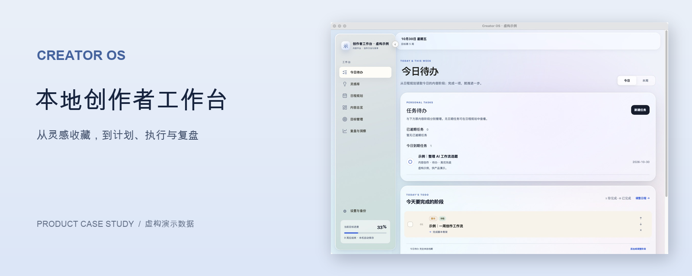
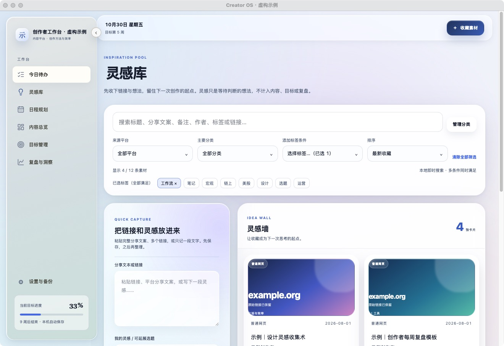
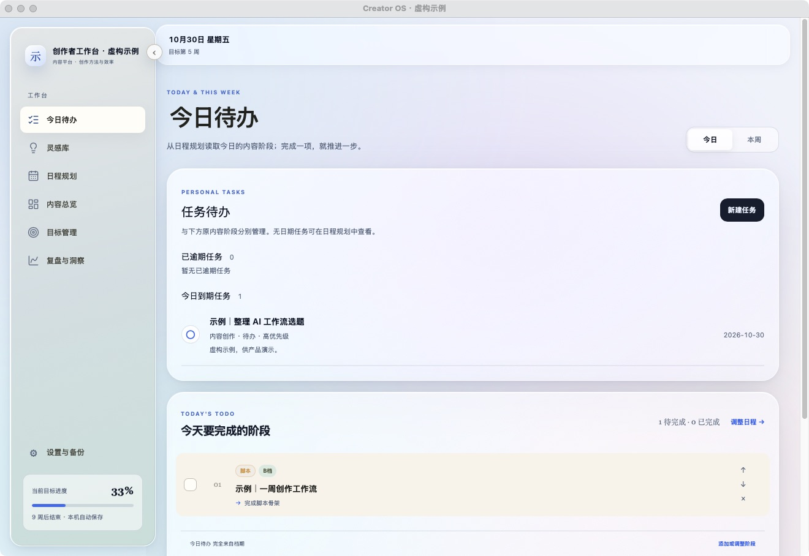
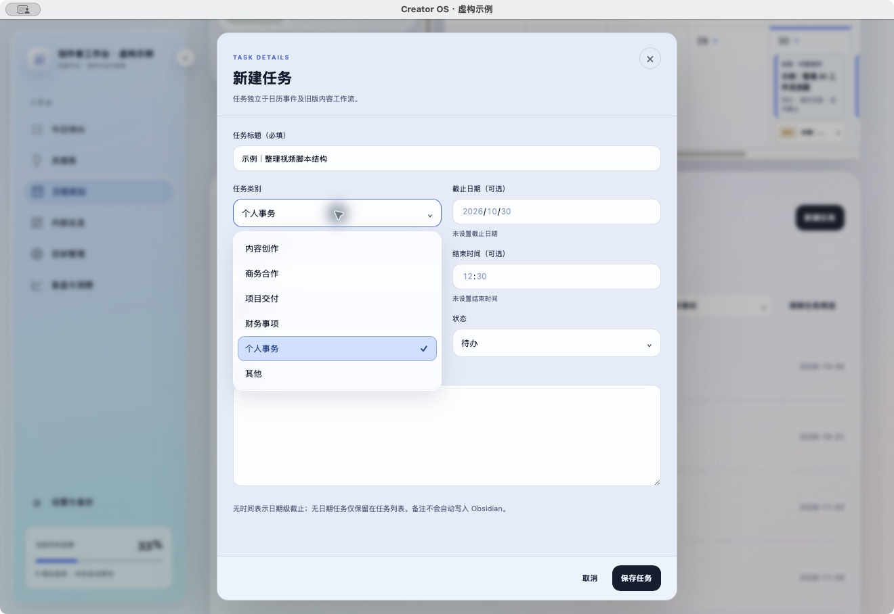
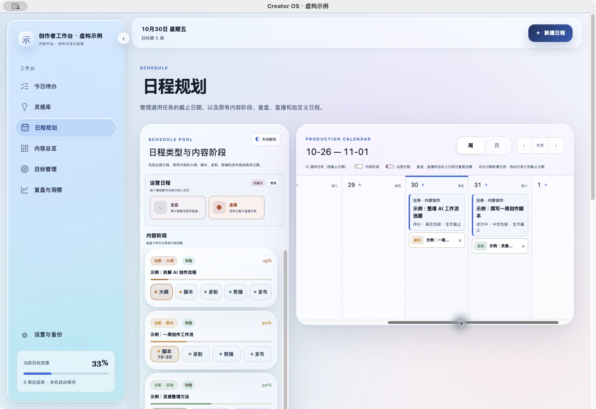
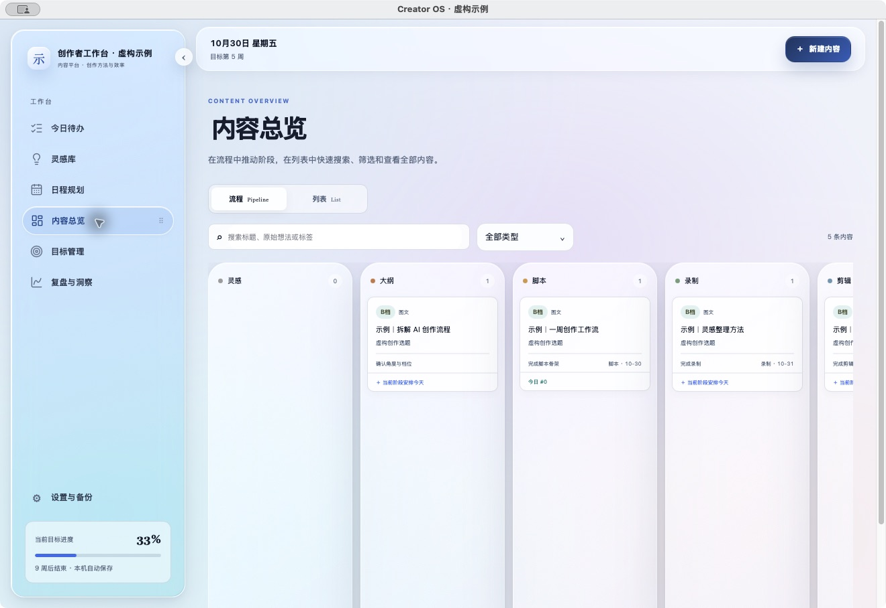
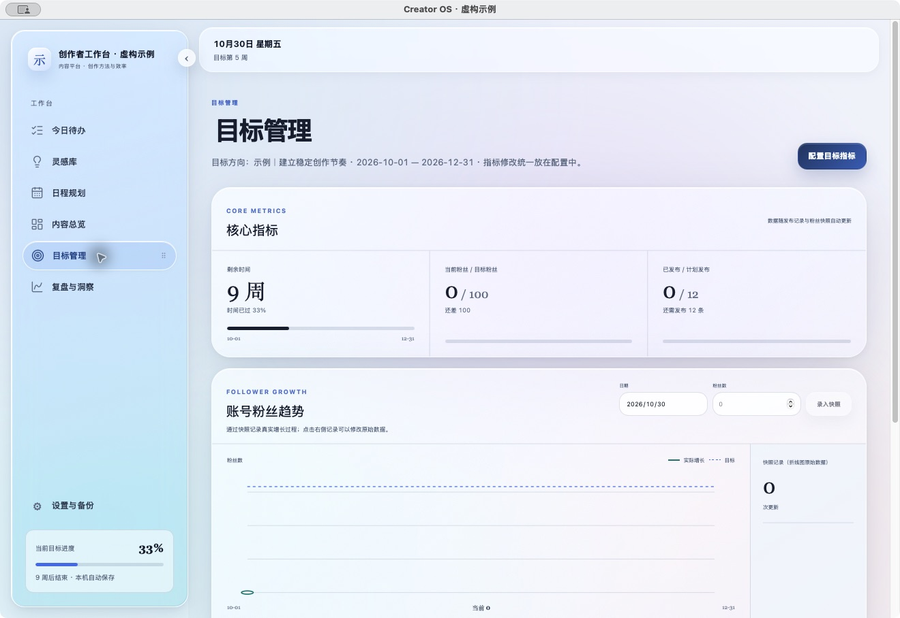
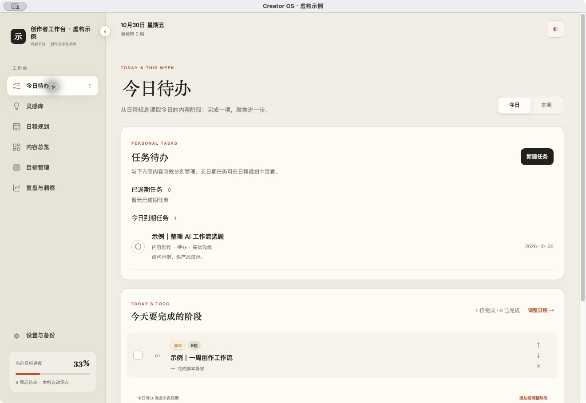
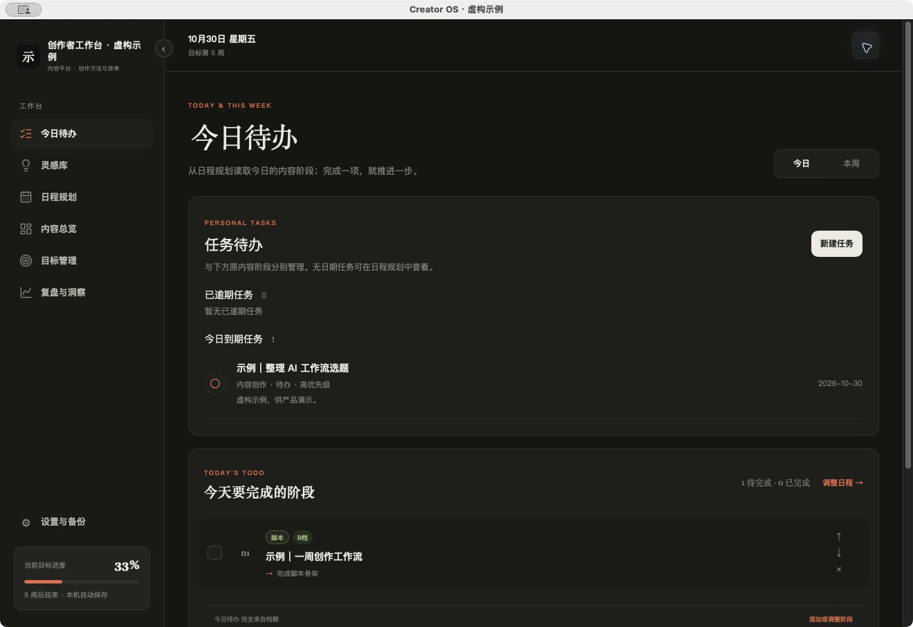

# Creator OS｜本地创作者工作台

Creator OS 是基于开源 [Creator Cockpit](https://github.com/AverrryHu/creator-cockpit) 增量开发的 macOS 本地创作者工作台。它帮助个人创作者把跨平台灵感整理成任务，在日程中安排，再通过内容流程和目标回看进度。

本仓库是 **Product Showcase**，用于展示产品案例和截图，不提供应用源码或可下载安装的软件。

> A local-first macOS creator workspace and product case study, built incrementally on the open-source Creator Cockpit.

**产品问题：**灵感散落在不同平台，收藏后不容易转化为下一步行动；创作任务、排期和内容状态也容易分散在不同工具中。

**我的角色：**产品规划与范围拆解、交互设计方向、AI 辅助开发的组织与审查、质量验收、迭代和发布决策。实现由人和 AI 辅助协作完成。

## 从灵感到行动

### 灵感管理

收藏链接或文字，通过分类、多标签与组合筛选找回素材。重复检测提供提醒和判断依据，由用户决定是否继续收藏，不自动合并。

### 任务与日程

通用任务独立于内容，支持状态、优先级和可选截止日期；今日待办与日程展示需要推进的事项。任务不会自动生成内容、客户或收入。

### 内容、目标与复盘

通过 Pipeline 或列表查看内容阶段；目标和复盘沿用上游内容经营模型，帮助创作者回看进度与经验。

### 适合自己的工作环境

界面提供 Apple Glass 和安静编辑部；后者支持浅色与深色。

以上画面均来自隔离 Demo 的真实 macOS 窗口，素材、任务及指标为**虚构示例**。Demo 基于开发分支，部分控件晚于正式 0.2.3，不能将所有画面视为正式版本已交付。

## 关键产品决策

- **重复提醒而非自动合并：**保留创作者对不同上下文和备注的判断，避免误合并；无法确认的情况不作确定性承诺。
- **任务独立于内容：**通用事务无需强行绑定内容，日程仍能同时展示任务和内容阶段。
- **本地优先与隔离验收：**数据保存在本机，提供 JSON 备份与恢复预览；测试使用独立工作区和虚构数据，避免污染日常工作区。

[阅读完整产品案例](docs/PRODUCT-CASE-STUDY.md) · [架构与数据边界](docs/ARCHITECTURE.md) · [迭代与验证记录](docs/ITERATION-HISTORY.md)

## 技术与验证

桌面端使用 Swift、AppKit、WKWebView；前端使用 React、TypeScript，工作区保存在本机 IndexedDB。任务保存检查冲突，备份恢复提供预览和显式选择。本地数据不会自动跨设备同步，远程素材信息等功能可能访问网络。

P1.3-A 记录 266 项测试、P2-A 记录 352 项、0.2.3 阶段记录 447 项测试及 lint、类型检查通过；数字分别属于不同阶段，不能相加，也不是外部用户验收。正式原生菜单问题曾触发回滚，后续重试与验收各有范围。**外部 Beta 尚未完成，当前没有公开下载包。**

## 演示视频

连贯操作演示将在录制和审核完成后补充。

## 上游与许可

Creator OS 基于 [Creator Cockpit](https://github.com/AverrryHu/creator-cockpit) 开发。上游已有内容流程、目标与复盘等基础能力；本项目的灵感整理、重复提醒、通用任务、导航主题和数据保护等工作为后续增量，详见[项目案例](docs/PRODUCT-CASE-STUDY.md)。[MIT License](LICENSE) 保留的是上游 Creator Cockpit 的许可与 Copyright © 2026 Avery 版权声明；本展示仓库不包含 Creator OS 私有源码，也不表示该源码已开源。更多说明见[开源归属](docs/ATTRIBUTION.md)。
