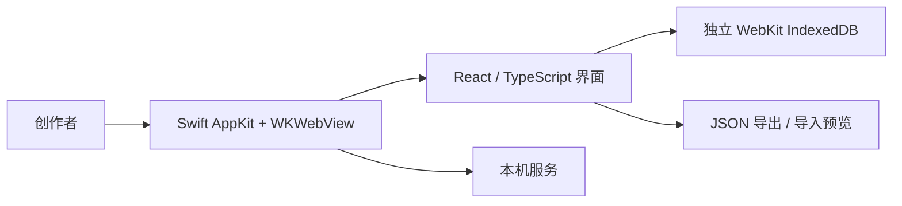

# 架构与数据边界

桌面应用通过本机服务加载前端，工作区放在 WKWebView 的独立数据存储中。普通浏览器有自己的存储，不自动与 App 同步。素材的远程元数据或图片可能发出网络请求；本地优先不等于所有功能都离线。可选 AI 功能依配置使用；没有配置密钥时提供可复制提示词，不能宣称自动完成内容创作。

数据保护包括读取失败时停止自动初始化、导入预览、显式合并或覆盖以及事务完成后反馈。任务事务读取最新记录并进行版本冲突检查，旧模块保存保留最新任务。备份需要用户主动导出并自行保管；这些措施不等于灾难恢复或跨设备同步已全面验证。

展示 Demo 使用单独 Bundle ID、Store 与端口，数据全部虚构。隔离环境曾验证关键交互和冷启动；这不代表正式工作区的完整验收或跨账户安装通过。当前正式 App 是本机环境绑定构建，不应作为公开安装包分发。
